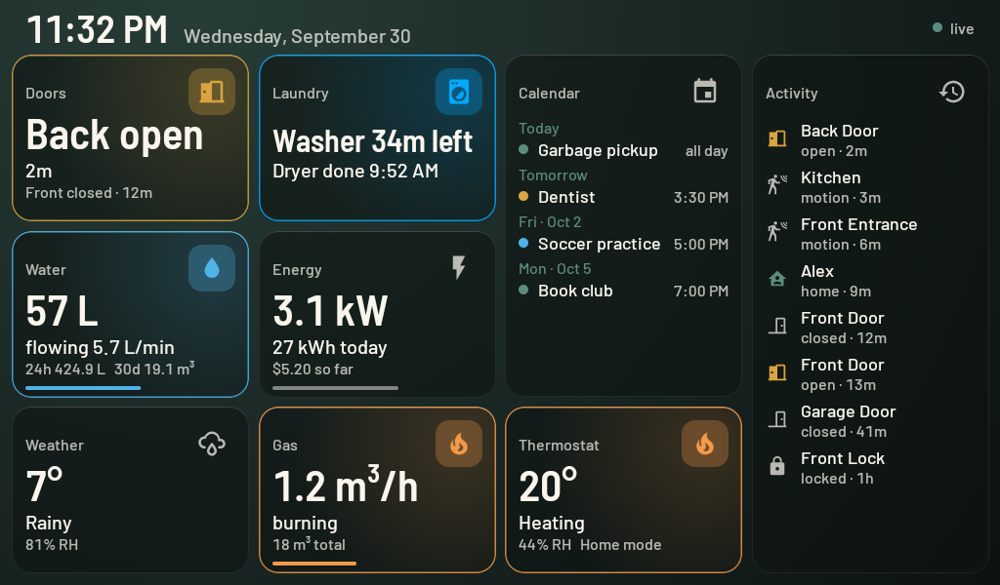
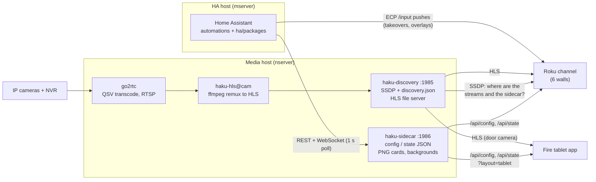

# HAku — Home Assistant wall displays

[](https://github.com/jimidarke/homewall/actions/workflows/ci.yml)
[](LICENSE)

**HAku** ("Home Assistant" + "Roku") turns the screens already in a house into one glanceable dashboard. Six Rokus show it as a Roku channel and a Fire 7 tablet on the kitchen wall shows it as an Android app. Both draw the same glass cards (doors, laundry, water, energy, gas, weather, thermostat, calendar, recent activity) with a live camera square. When Home Assistant has something to say (the front door opens, motion after dark), every wall cuts to the right camera and drifts back a minute later.



*The tablet app running on its demo data. Roku screenshots: TODO, see [`docs/roku/screens/`](docs/roku/screens/).*

This is a personal project, used every day in one house. It is published as a worked example of a small multi-platform system: three runtimes, one data contract, golden-file tests that keep them honest, and a development history written almost entirely with an AI pair (see [How this was built](#how-this-was-built-with-claude-code)).

## Components

| Folder | What | Stack | Runs on |
|---|---|---|---|
| [`sidecar/`](sidecar/) | Reads Home Assistant and serves ready-to-draw JSON (config + state) and rendered PNG cards to both clients | Python 3, Flask, waitress, Pillow, matplotlib | media host (`nserver`) |
| [`roku/`](roku/) | The Roku channel: 6×4 glass wall, live camera, full-screen takeovers, overlays | BrightScript + SceneGraph, brighterscript | six wall Rokus |
| [`fire-tablet/`](fire-tablet/) | The kitchen tablet app: the same wall with touch detail panels | Kotlin, Jetpack Compose, OkHttp | Fire 7 (Fire OS 8, API 30) |
| [`stream/`](stream/) | Camera pipeline: go2rtc (Intel Quick Sync transcodes), ffmpeg HLS remuxers, an SSDP + HTTP discovery service | go2rtc, ffmpeg, systemd, Python stdlib | media host |
| [`ha/`](ha/) | The Home Assistant packages HAku relies on: ECP pushes to the Rokus, utility meters, the laundry state machine | HA YAML | HA host (`mserver`) |
| [`tools/`](tools/) | `baseline.sh`: measures the live system (traffic, CPU, memory, restarts) into a Markdown report | bash | workstation |
| [`docs/`](docs/) | System design, tablet design, specs and plans, measured baselines | Markdown | — |

## Architecture



**One contract, two clients.** The sidecar owns display formatting: every tile arrives with its hero value, sub-line, severity, glyph and accent already decided, and each layout (`?layout=roku`, `?layout=tablet`) is a grid in the same config file. The clients only lay out, animate and play video. A change to the sidecar's JSON therefore has to keep two very different runtimes working, which is what the tests below pin down.

**No hard-coded addresses on the clients.** A Roku finds the media host with an SSDP M-SEARCH, reads `discovery.json` (stream URLs and the sidecar's base) and caches it in the registry, so it also starts cleanly when discovery is slow. The stream server re-reads go2rtc's stream list every minute, so a camera added to `go2rtc.yaml` shows up without restarting anything.

Full design: [`docs/HAKU_DESIGN.md`](docs/HAKU_DESIGN.md) (Roku channel, pipeline, sidecar, HA integration) and [`docs/fire-tablet/DESIGN.md`](docs/fire-tablet/DESIGN.md).

## Testing

| Suite | What it guards | Run |
|---|---|---|
| Sidecar, ~610 pytest cases | Every module's values and detail panels, layouts, HA client, history, backgrounds, plus **golden files**: `sidecar/tests/golden/roku_config.json` and `roku_state.json` are the Roku's default output for a rich fixture house at a frozen clock, compared **byte for byte** | `cd sidecar && python -m pytest tests -q` |
| Discovery service, 16 cases | The discovery.json schema, SSDP request/response, the HLS file server's path rules | `python -m pytest stream/tests -q` |
| Roku unit, ~330 assertions | Pure BrightScript helpers (formatting, layout maths, backoff, routing decisions), run headless with `@rokucommunity/brs` | `cd roku && npm test` |
| Roku contract | `discovery_contract.py` and `layout_contract.py` check the live (or fixture) discovery and sidecar output against what the channel reads | `HAKU_FIXTURE=1 npm run test:contract` |
| Tablet, ~350 JVM tests | Parsing of fixtures captured from the sidecar (`app/src/test/resources/`), view-model state, polling, backdrop loading | `cd fire-tablet && ./gradlew testDebugUnitTest` |
| Roku smoke (device) | Sideloads to a real Roku and drives it over ECP: takeovers, overlays, the camera picker, no runtime errors | `roku/tests/smoke/smoke.sh` |

Golden files are regenerated on purpose, never by accident: `HAKU_UPDATE_GOLDEN=1 python -m pytest tests/test_roku_golden.py` rewrites them, and the diff goes into the commit for review. [CI](.github/workflows/ci.yml) runs everything except the device smoke test.

## Repository layout

```
roku/          Roku channel: components/ (SceneGraph), source/ (shared BrightScript), tests/, scripts/
fire-tablet/   Android app (Gradle): app/src/main (Compose UI), app/src/test (fixtures + JVM tests)
sidecar/       haku_sidecar/ (Flask app, one module per card kind), tests/ (+ golden/), systemd units
stream/        go2rtc.yaml, systemd units, haku-discovery.py, tests/
ha/            Home Assistant packages + secrets.example.yaml
config/        dashboard.live.example.json: a sanitized copy of the live sidecar config
tools/         baseline.sh + lib/ + tests/
docs/          HAKU_DESIGN.md, fire-tablet/DESIGN.md, baseline/, superpowers/specs + plans, brand/
CLAUDE.md      and one per folder: working notes for AI-assisted development
```

## How this was built with Claude Code

Every commit in this repository was written in a pair-programming loop with Claude Code and carries a `Co-Authored-By: Claude …` trailer (`git log --grep "Co-Authored-By: Claude" --oneline | wc -l`). The parts of the workflow that are visible in the repo:

- **A `CLAUDE.md` per component** ([root](CLAUDE.md), [roku](roku/CLAUDE.md), [sidecar](sidecar/CLAUDE.md), [stream](stream/CLAUDE.md), [fire-tablet](fire-tablet/CLAUDE.md), [docs](docs/CLAUDE.md)). They hold what a new contributor, human or model, needs before touching that part: the commands, the contracts it must not break ("the sidecar has two clients"), deploy rules ("diff the server before you copy"), and hard-won device facts (Roku OS stops a stream after 4 h without input; the Express can't decode HEVC).
- **Specs before plans before code.** Larger changes start as a design spec in [`docs/superpowers/specs/`](docs/superpowers/specs/), become a step-by-step implementation plan in [`docs/superpowers/plans/`](docs/superpowers/plans/) with tests named up front, and are then executed task by task. They stay in the repo as records of decisions, including the ones that were later reversed.
- **Measure, then decide.** `tools/baseline.sh` captures the live system's numbers (requests per second per client, bytes from Home Assistant, CPU and memory per process, unit restarts) into [`docs/baseline/`](docs/baseline/), so a redesign is argued from data rather than taste.
- **Tests as the shared ground truth.** The golden files and the fixture-driven contract tests are what let large AI-assisted edits land safely across three languages.

## Migration story

HAku grew as two repositories: `roku-homewall` (the Roku channel, the sidecar and the stream pipeline) and `tablet-homewall` (the Android app). The first commit in this repo ([`1ee1c40`](https://github.com/jimidarke/homewall/commit/1ee1c4095a9cdb24e528b79dd37cfc83fc32938e), "initial import of HAku into the homewall monorepo") consolidates them: a path mapping (`roku-homewall/channel` → `roku/`, `server/sidecar` → `sidecar/`, `tablet-homewall` → `fire-tablet/`, docs gathered under `docs/`), the drift found on the live server folded back in, living docs repointed, and every suite re-run green in the new layout. The older specs and plans keep their original paths; [`docs/superpowers/README.md`](docs/superpowers/README.md) maps them.

The next step is a planned re-architecture. [`docs/superpowers/specs/2026-10-24-haku-v2-design.md`](docs/superpowers/specs/2026-10-24-haku-v2-design.md) starts from the measured v1 baseline ([`docs/baseline/2026-10-24.md`](docs/baseline/2026-10-24.md): the sidecar pulling about 25 GB a day from Home Assistant whether or not a screen is on, the same door rule implemented in five places, a contract pinned by snapshots) and lays out v2: the server owns the view-model, Home Assistant emits events instead of pushing to device IPs, a schema'd contract, honest health, one-command deploys, built beside v1 and cut over once. Phase 0, the hygiene that is safe to do before the rebuild (secrets out of docs, the live config tracked, a reproducible baseline), is done (since the repo went public, the live config is tracked on the workstation rather than in git) ([plan](docs/superpowers/plans/2026-10-24-haku-v2-phase0-hygiene.md)); the "numbers to beat" in the spec's § 11 are re-measured with the same script after the cutover.

## Private configuration

The repository is public; the house is not. Everything specific to it stays out of git:

| What | Where it lives | Template in the repo |
|---|---|---|
| HA token, camera logins and addresses | `/etc/haku/haku.env`, `/etc/haku/cam-creds.env` on the media host | [`stream/README.md`](stream/README.md) § Camera credentials |
| Live sidecar config | `config/live/` (gitignored), `/etc/haku/dashboard.json` | [`config/dashboard.live.example.json`](config/dashboard.live.example.json), [`sidecar/dashboard.json.example`](sidecar/dashboard.json.example) |
| Roku addresses and dev passwords | `~/.config/haku/fleet.env` | [`roku/fleet.env.example`](roku/fleet.env.example) |
| Device URLs and the phone's notify action used by HA packages | Home Assistant's `secrets.yaml` | [`ha/secrets.example.yaml`](ha/secrets.example.yaml) |
| The tablet build's sidecar URL | `fire-tablet/local.properties` (gitignored) | [`fire-tablet/README.md`](fire-tablet/README.md) § Build |
| Device inventory (addresses, MACs, rooms) | `PRIVATE.md` (gitignored) | — |

Addresses that appear in the docs and fixtures are [RFC 5737](https://www.rfc-editor.org/rfc/rfc5737) documentation addresses (`192.0.2.0/24`), and the people in fixtures are fictional.

## Versions

Release 1.0.0 (tag `v1.0.0`) set every part to 1.0.0; they version independently from there. Each part's version lives in `roku/VERSION.txt` (with `roku/manifest` and `roku/package.json`), `fire-tablet/app/build.gradle.kts`, `sidecar/haku_sidecar/__init__.py` and `stream/haku-discovery.py` (`SERVICE_VERSION`). Deploys are manual per host (each part's README has the steps), so a display can lag the repo.

## License

[MIT](LICENSE) © Jimi Darke. Bundled fonts and icon sets keep their own licences, next to them in `roku/fonts/` and `sidecar/haku_sidecar/assets/`.
